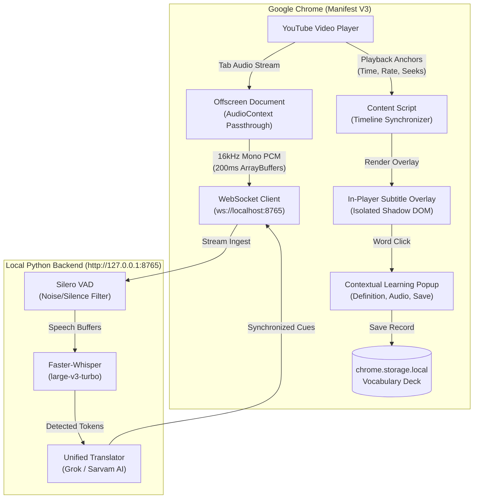

**Team Name:** V-Clubs  
**Team ID:** 7881  

# LiveSub 🎥 🔤

> **Real-Time Multilingual Subtitles & Interactive Contextual Vocabulary Learning for Any Video in Your Browser.**

[](#license)
[](#extension-installation)
[](#backend-setup)
[](#testing--verification)

---

## 📺 Demo Video

🎬 **[Watch the LiveSub Demo on Google Drive](https://drive.google.com/drive/folders/1NCI7As2cMbSUyphjDg1kIyZkPECTBrCX?usp=sharing)**  
*(Please ensure your Google account has viewer access or contact team V-Clubs if access is restricted).*

---

## ⚠️ Backend Availability for Judging

> **DEPLOYMENT STATUS: The LiveSub backend is not currently deployed to a public cloud URL.**
>
> The speech-recognition and translation pipeline executes high-throughput neural models (`Whisper large-v3-turbo`, `Silero VAD`, and `WhisperX`) designed for low-latency local execution. 
> 
> **For Judges:**
> - To evaluate the live speech-to-text pipeline, the backend must be running locally on the team's demonstration laptop (or an accessible LAN workstation) at `http://localhost:8765`.
> - Loading the extension alone is sufficient to test **Learning Mode**, **Vocabulary Storage**, **Review Flashcards**, **Exporting (SRT/VTT)**, and **Settings UI**.
> - Live tab audio transcription requires the backend to be running as documented in [Local Backend Startup Instructions](#-local-backend-startup-instructions).

---

## 📦 Judge-Ready Extension ZIP (Pre-Built)

Judges can test the Chrome Extension in 30 seconds using the pre-compiled submission artifact included in this repository:

📁 **Location in Repository:** [`dist/livesub-extension.zip`](dist/livesub-extension.zip)

### How Judges Can Load the Extension in Google Chrome:
1. Download or clone this repository and locate [`dist/livesub-extension.zip`](dist/livesub-extension.zip).
2. Extract `livesub-extension.zip` into any local folder (e.g., `Desktop/livesub-extension`).
3. Confirm that `manifest.json` is located **directly at the root** of that extracted folder.
4. Open Google Chrome and navigate to `chrome://extensions/`.
5. Enable **Developer mode** using the toggle switch in the top right corner.
6. Click **Load unpacked** in the top left corner.
7. Select the extracted folder containing `manifest.json`.
8. The **LiveSub** extension will appear with its icon ready in the browser toolbar!

---

## 💡 The Problem LiveSub Solves

1. **Missing or Inaccurate Captions:** Millions of educational videos, webinars, regional podcasts, and indie tutorials have zero captions or low-quality auto-generated transcripts that misinterpret non-Western accents and technical terms.
2. **Indian Language Underrepresentation:** Mainstream platforms lack reliable real-time subtitle translation for Indian languages like Hindi, Tamil, Telugu, and Marathi.
3. **Passive Watching vs. Active Learning:** Language learners frequently pause videos to look up unknown words in third-party dictionaries, breaking immersion and cognitive flow.
4. **Code-Mixed & Idiomatic Speech:** Traditional translation misses regional idioms, transliterated colloquialisms, and conversational nuances.

### The LiveSub Solution
LiveSub provides a seamless, non-intrusive subtitle overlay that:
- Captures tab audio directly using Chrome Manifest V3 offscreen processing.
- Streams audio in 200ms chunks to a local Faster-Whisper pipeline.
- Renders synchronized bilingual subtitles inside YouTube with zero player degradation.
- Introduces **Learning Mode**: click any subtitle word to instantly view contextual meanings, translations, phonetics, and audio pronunciation, then save it to a personal vocabulary deck for spaced-repetition review.

---

## ✨ Verified Features

| Feature | Status | Description |
|---|---|---|
| **Real-Time Tab Audio Capture** | ✅ Implemented | `chrome.tabCapture` via Manifest V3 offscreen document with native audio passthrough |
| **Streaming Whisper Transcription** | ✅ Implemented | Incremental Faster-Whisper `large-v3-turbo` with Silero VAD silence filtering |
| **Multilingual Translation** | ✅ Implemented | Contextual translation supporting English, Hindi, Tamil, Marathi, and Telugu |
| **In-Player Subtitle Overlay** | ✅ Implemented | Shadow DOM rendering with custom font size, opacity, and positioning |
| **Timeline Drift Sync** | ✅ Implemented | Samples video playback rate, pause/seek state, and discards stale cues during ads |
| **Clickable Word Learning Mode** | ✅ Implemented | Interactive `.ls-word` spans with contextual popovers, definitions, and pronunciation |
| **Persistent Vocabulary Store** | ✅ Implemented | Browser local storage with deduplication (`word::sourceLang::targetLang`) |
| **Flashcard Review Mode** | ✅ Implemented | Spaced-repetition flashcards in the extension with "Remembered" / "Review Again" |
| **Subtitle Studio Web App** | ✅ Implemented | Standalone video upload studio at `http://localhost:5173` with video burn-in & SRT export |
| **Subtitle Export** | ✅ Implemented | Clean exports to SRT, WebVTT, Plain Text, and JSON formats |
| **Speaker Diarization** | ⚡ Available | Pyannote Audio speaker labeling when HuggingFace token is configured |

---

## 🏗️ Architecture Overview

For a detailed one-page architecture brief, read [`docs/ARCHITECTURE.md`](docs/ARCHITECTURE.md).



---

## 🚀 Local Backend Startup Instructions

### 1. Prerequisites
- **Python:** 3.10, 3.11, or 3.12 (64-bit recommended)
- **Node.js:** 18+ (tested on Node v20/v24)
- **FFmpeg:** Installed and available in your system `PATH`
- **GPU (Recommended):** NVIDIA GPU with CUDA 11.8/12.1 for sub-500ms latency (CPU mode works automatically as fallback)

### 2. Backend Installation (Terminal 1)
```powershell
# Navigate to the repository root
cd LiveSub

# Create a virtual environment
python -m venv venv

# Activate the virtual environment
# Windows PowerShell:
.\venv\Scripts\Activate.ps1
# Linux / macOS:
# source venv/bin/activate

# Install backend dependencies
pip install -r backend/requirements.txt
```

### 3. Environment Configuration
Create or verify `.env` in the repository root:
```env
# Optional API keys for cloud translation & speaker diarization
GROQ_API_KEY=your_groq_api_key_here
SARVAM_API_KEY=your_sarvam_api_key_here
HF_TOKEN=your_huggingface_token_here
```
*(If keys are omitted, LiveSub falls back to local translation heuristics and client-side Google GTX).*

### 4. Start the Backend Server
```powershell
python -X utf8 backend/run_server.py
```
**Expected Output:**
```
[LiveSub Backend] Starting on http://127.0.0.1:8765 ...
[LiveSub Backend] Initializing models and VAD...
INFO:     Uvicorn running on http://127.0.0.1:8765 (Press CTRL+C to quit)
```

### 5. Verify Backend Health
Open your browser and visit:
👉 **`http://127.0.0.1:8765/api/health`**  
You should receive a JSON response showing `"status": "ok"` and `"backend": "LiveSub"`.

---

## 💻 Web Studio Quick Start (Optional)

In addition to the browser extension, LiveSub includes a standalone web studio for uploading local video files, generating synchronized bilingual subtitles, and exporting videos with burned-in captions:

```powershell
cd web
npm install
npm run dev
# Opens at http://localhost:5173
```

---

## ⏱️ Five-Minute Demo Plan for Judges

| Time | Segment | Demonstration Activity |
|---|---|---|
| **0:00–0:30** | **The Hook & Problem** | Explain why passive video watching fails language learners and demonstrate an uncaptioned YouTube video in an Indian language. |
| **0:30–1:00** | **System Architecture** | Highlight the Manifest V3 offscreen audio tap, 200ms PCM chunking, and local Faster-Whisper pipeline. |
| **1:00–2:30** | **Live Subtitle Generation** | Start video playback. Show real-time bilingual subtitles rendering in the YouTube player with zero audio disruption. |
| **2:30–3:30** | **Seeking & Ad Synchronization** | Fast-forward 45 seconds or scrub the player; observe how timestamps re-anchor instantaneously without subtitle drift. |
| **3:30–4:15** | **Interactive Learning Mode** | Click an individual word (e.g., *"beautiful"* or *"namaste"*). Show the contextual definition popover, target translation, and audio pronunciation. Click **Save Word**. |
| **4:15–5:00** | **Extension Vocabulary Deck & Q&A** | Open the LiveSub extension popup. Navigate to the **Vocabulary** tab, search saved items, and launch **Flashcard Review Mode**. Conclude with privacy and technical Q&A. |

---

## 💬 Technical Viva: Top Questions & Answers

<details>
<summary><strong>1. How does LiveSub capture audio without violating Chrome Manifest V3 restrictions?</strong></summary>
<p>LiveSub uses <code>chrome.tabCapture.getMediaStreamId</code> in the background service worker, passing the stream ID to a dedicated Chrome Offscreen document initialized with the <code>USER_MEDIA</code> justification. The offscreen document creates a native <code>AudioContext</code>, pipes audio directly to <code>audioCtx.destination</code> (ensuring the user still hears clear audio), and routes a resampled 16kHz mono PCM stream via a <code>ScriptProcessorNode</code> over a local WebSocket.</p>
</details>

<details>
<summary><strong>2. How do you keep subtitles synchronized during seeks and speed adjustments?</strong></summary>
<p>The content script attaches listeners to the HTML5 video element, capturing <code>currentTime</code>, <code>playbackRate</code>, and seek events every 100ms. These are transmitted as metadata anchors alongside the audio stream. When a seek or ad break occurs, the server-side VAD and speech buffer are flushed immediately, preventing old audio from generating phantom cues.</p>
</details>

<details>
<summary><strong>3. Which speech recognition and translation models are used?</strong></summary>
<p>LiveSub runs <strong>Faster-Whisper</strong> with the <code>large-v3-turbo</code> model quantized via CTranslate2 for high-speed inference. For Voice Activity Detection, we run <strong>Silero VAD v4</strong>. Translations utilize our <code>UnifiedTranslator</code>, prioritizing Grok / xAI LLM translation for idioms and nuances, with Sarvam AI fallback for Indian regional languages.</p>
</details>

<details>
<summary><strong>4. Where does audio data go, and how is user privacy protected?</strong></summary>
<p>Raw audio <strong>never leaves the user's local machine</strong>. Tab audio is streamed exclusively to <code>ws://localhost:8765</code>, processed in volatile system RAM, and immediately garbage-collected after inference. No audio recordings or transcripts are logged to any external third-party server.</p>
</details>

<details>
<summary><strong>5. Why is the backend running locally instead of being deployed publicly?</strong></summary>
<p>Live real-time Whisper Turbo transcription requires dedicated GPU compute (NVIDIA Tensor Cores) and persistent binary WebSockets. Running locally ensures true sub-second latency without expensive cloud GPU hosting bottlenecks, unpredictable API rate limits, or audio privacy exposure.</p>
</details>

<details>
<summary><strong>6. How does word-level Learning Mode work?</strong></summary>
<p>Our custom tokenizer (<code>word-tokenizer.ts</code>) segments multi-script text (Latin, Devanagari, Tamil, Telugu) into interactive DOM nodes while preserving all attached punctuation, capitalization, and hyphens. Clicking a word queries the Free Dictionary API and our translation service, returning contextual definitions and triggering Web Speech API audio pronunciation.</p>
</details>

---

## 📂 Repository Directory Tree

```
LiveSub/
├── dist/
│   └── livesub-extension.zip    # ⭐ Judge-ready submission ZIP (manifest.json at root)
├── docs/
│   └── ARCHITECTURE.md          # 📐 Concise 1-page architecture & data flow note
├── extension/                   # 🧩 Chrome Extension (Manifest V3 + WXT + React 19)
│   ├── entrypoints/
│   │   ├── background.ts        # Tab audio capture orchestration
│   │   ├── offscreen/           # Web Audio API resampler & WebSocket bridge
│   │   ├── popup/               # Extension popup UI (Vocabulary & Settings)
│   │   └── youtube.content/     # In-player Shadow DOM overlay injector
│   ├── src/
│   │   ├── audio/               # PCM resampler & video anchor tracking
│   │   ├── learning/            # Word tokenizer, popup card, vocabulary store & review
│   │   └── overlay/             # SubtitleOverlay component & styling
│   └── tests/                   # 17 Vitest test suites (102 tests)
├── backend/                     # 🐍 Python FastAPI AI Backend
│   ├── app/
│   │   ├── audio/vad.py         # Silero VAD implementation
│   │   ├── models/              # Faster-Whisper & WhisperX engines
│   │   ├── translation/         # UnifiedTranslator (Grok + Sarvam AI)
│   │   └── main.py              # WebSocket & REST endpoints
│   ├── requirements.txt         # Backend Python dependencies
│   └── run_server.py            # Local server entry point (port 8765)
├── web/                         # 🌐 Standalone Video Subtitle Studio (Vite + React)
├── scripts/
│   └── package_extension.py     # 📦 Automated extension builder & ZIP validator
├── .gitignore                   # Git configuration permitting dist/livesub-extension.zip
└── README.md                    # 📖 Master Hackathon Documentation
```

---

## 🧪 Testing & Verification

All automated tests across the entire repository can be verified with:

```powershell
# 1. Run Extension Unit Tests (17 test files, 102 tests)
cd extension
npm test

# 2. Build Production Extension
npm run build

# 3. Package and Validate Extension ZIP
npm run package:extension

# 4. Run Web Studio Tests
cd ../web
npm test
```

**Real Test Results:**
- **Extension Tests:** 17/17 suites passed (102/102 unit tests).
- **Web Studio Tests:** 2/2 suites passed (9/9 unit tests).
- **Extension ZIP:** Generated and verified at `dist/livesub-extension.zip` (171.93 KB) with `manifest.json` at root.

---

## 📜 License & Acknowledgements

- **License:** MIT License.
- **Speech Models:** OpenAI Whisper team & Faster-Whisper (`guillaumekln/faster-whisper`).
- **Voice Activity Detection:** Silero VAD (`snakers4/silero-vad`).
- **Translation:** Grok API (xAI) and Sarvam AI.
- **Extension Framework:** WXT framework (`wxt.dev`).

---

**Team V-Clubs (Team ID: 7881) — Built with passion for accessible, multilingual video learning.**
