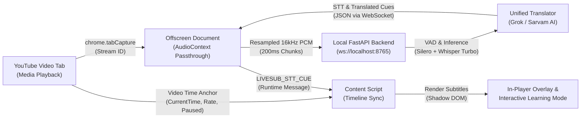

# LiveSub — System Architecture Note

**Team Name:** V-Clubs | **Team ID:** 7881 | **Project:** LiveSub

---

## 1. High-Level Architecture Diagram

---

## 2. Audio Capture Path

- **Source:** Browser tab audio extracted via Chrome Manifest V3 APIs (`chrome.tabCapture.getMediaStreamId`).
- **Context:** An offscreen HTML document (`offscreen.html`) is spun up with `USER_MEDIA` justification.
- **AudioPassthrough:** Tab audio stream is routed through `AudioContext.destination` so the user continues hearing native video audio without interruption.
- **Resampling:** A `ScriptProcessorNode` processes native audio buffers (4096 frames) and resamples stereo/mono audio down to **16kHz 16-bit mono PCM** via linear interpolation ([`pcm-resampler.ts`](../extension/src/audio/pcm-resampler.ts)).

---

## 3. Chunking & Buffering Pipeline

- **Chunk Size:** Accumulated in 3,200 sample buffers (**200ms chunks at 16kHz**).
- **Transport:** Binary `ArrayBuffer` frames transmitted over persistent WebSocket (`ws://localhost:8765/api/ws/audio`).
- **Lookahead Video Pre-Processing:** An optional REST endpoint (`POST /api/video/pre-process`) uses `yt-dlp` and `WhisperX` to pre-generate word-level aligned cues for 0ms latency buffering.
- **Silence & VAD:** `SileroVAD` classifies incoming frames on the backend. Speech segments are queued into `StreamingSpeechProcessor`, emitting incremental partial cues and final cues.

---

## 4. AI Models & Inference Runtime

| Component | Model / Engine | Runtime Location | Purpose |
|---|---|---|---|
| **Voice Activity Detection** | Silero VAD (v4 ONNX/PyTorch) | Local Python Backend | Filters background noise & silence |
| **Speech-to-Text** | Whisper `large-v3-turbo` via `faster-whisper` (CTranslate2) | Local CPU / NVIDIA CUDA | Multilingual transcription with timestamps |
| **Forced Alignment & Diarization** | WhisperX + Pyannote 3.1 (Optional) | Local Backend | Word-level timing & multi-speaker attribution |
| **Contextual Translation** | `UnifiedTranslator` (Grok/xAI API -> Sarvam AI) | Cloud API via Local Backend | Idiomatic translation into Tamil, Hindi, Marathi, Telugu |
| **Client-Side Dictionary** | Free Dictionary API + Web Speech API | Extension Client | Contextual definitions & word pronunciation |

---

## 5. Subtitle Synchronization & Video Alignment

- **Timeline Anchoring:** Content scripts sample `video.currentTime`, `playbackRate`, and paused state every 100ms.
- **Drift Compensation:** Audio packets carry timestamp anchors (`anchor.videoTime`, `anchor.perfNow`). When users seek, scrub, or encounter YouTube mid-roll ads, an `isSeek` / `isAd` signal resets STT buffers to prevent stale subtitle drift.
- **Overlay Rendering:** Cues render inside an isolated `closed` Shadow DOM attached to `#movie_player`. It includes custom subtitle placement, font size, contrast controls, and word tokenization for **Learning Mode**.

---

## 6. Privacy & Data Lifecycle

- **No Remote Audio Storage:** Tab audio PCM streams are processed ephemerally in RAM by the local backend and immediately discarded.
- **No Third-Party Audio Telemetry:** Audio does not leave the local machine. Only text strings are passed to the configured translation service (Grok / Sarvam AI).
- **Client Storage:** Vocabulary entries and extension settings are stored strictly in the user's browser sandbox via `chrome.storage.local`.

---

## 7. Current Architectural Constraints

- **Local Backend Dependency:** The backend is **not hosted publicly**; it runs locally at `http://localhost:8765`.
- **Hardware Acceleration:** Optimal real-time STT latency (<500ms) benefits from an NVIDIA GPU with CUDA; CPU inference runs in fallback mode with slightly longer buffering.
